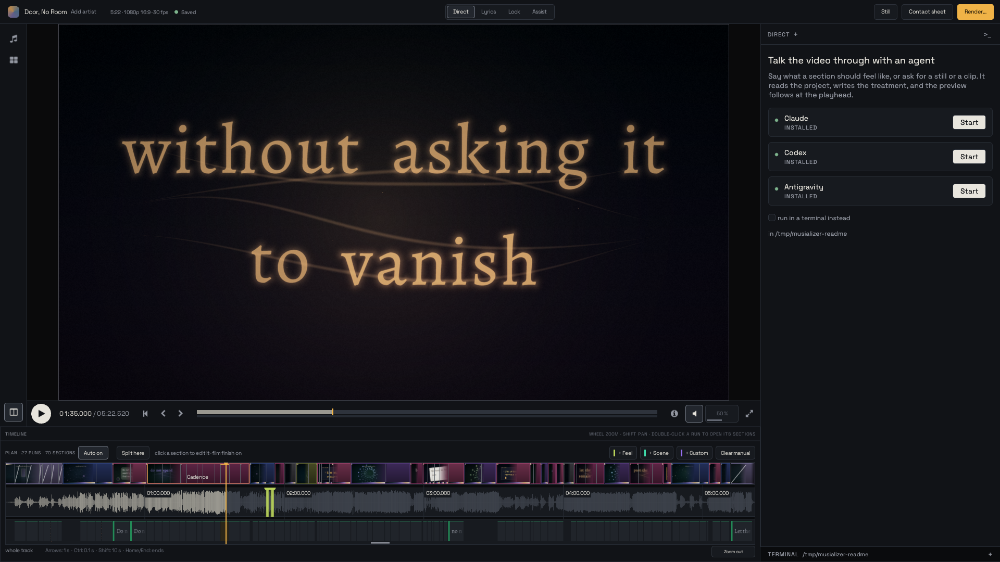
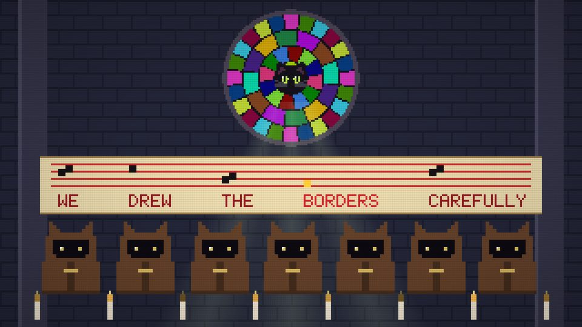
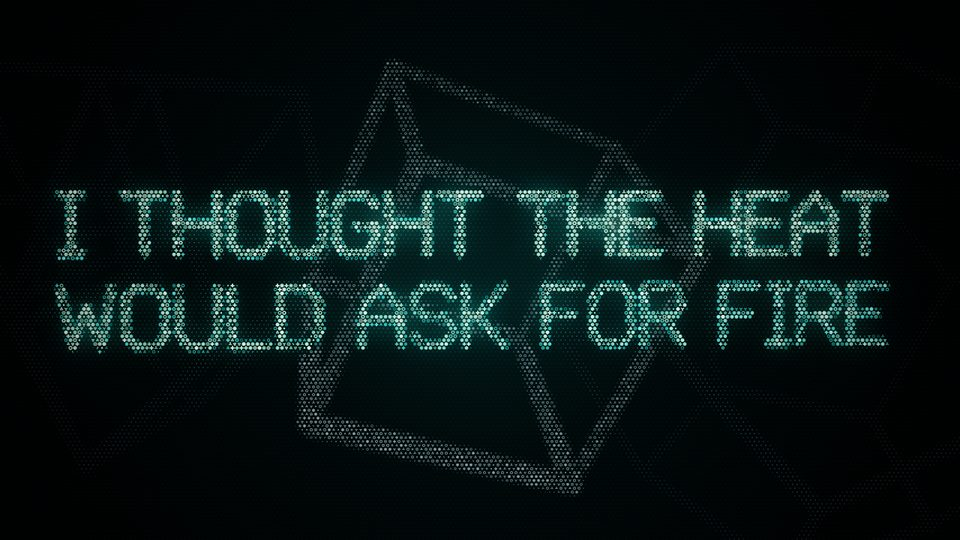
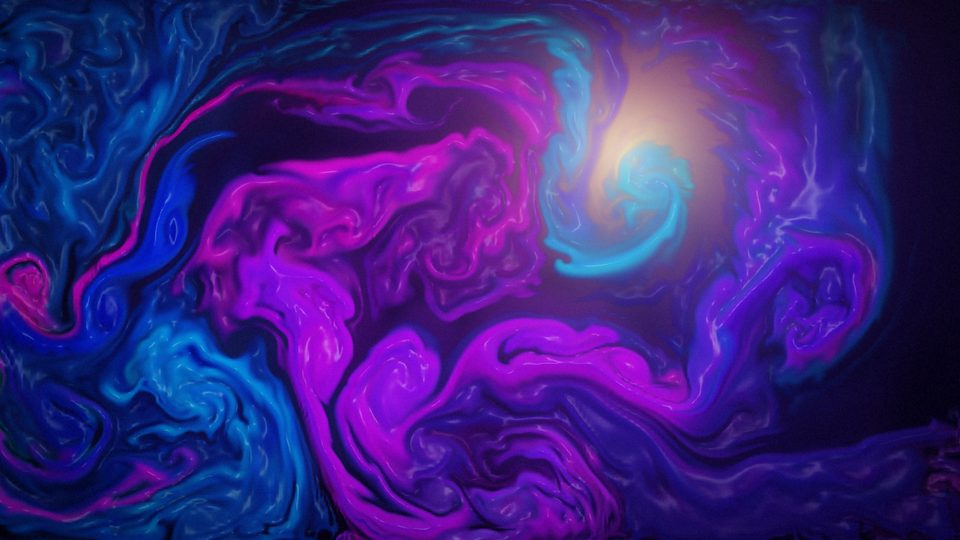
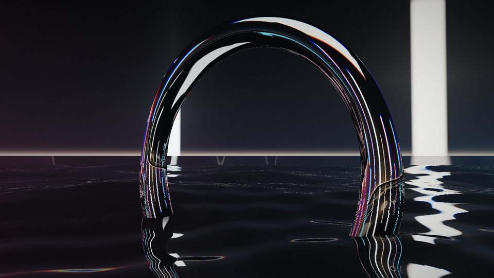
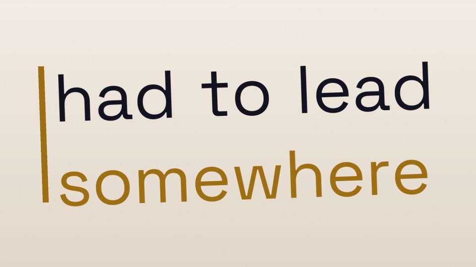
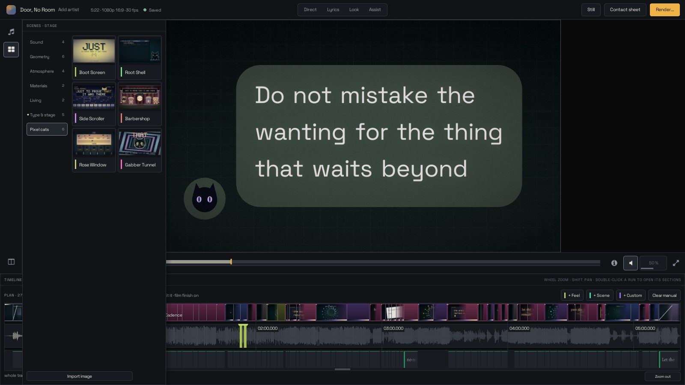
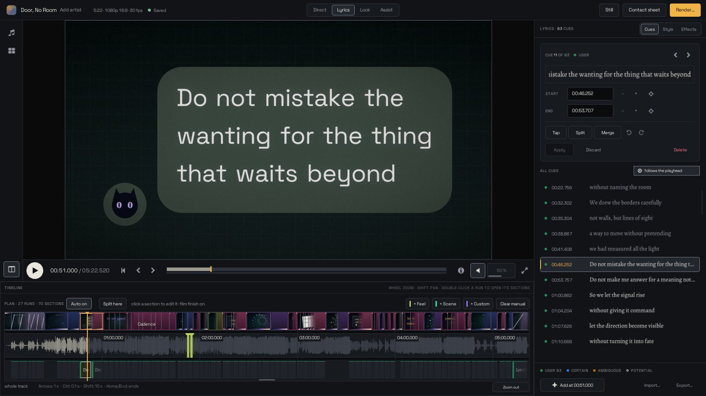
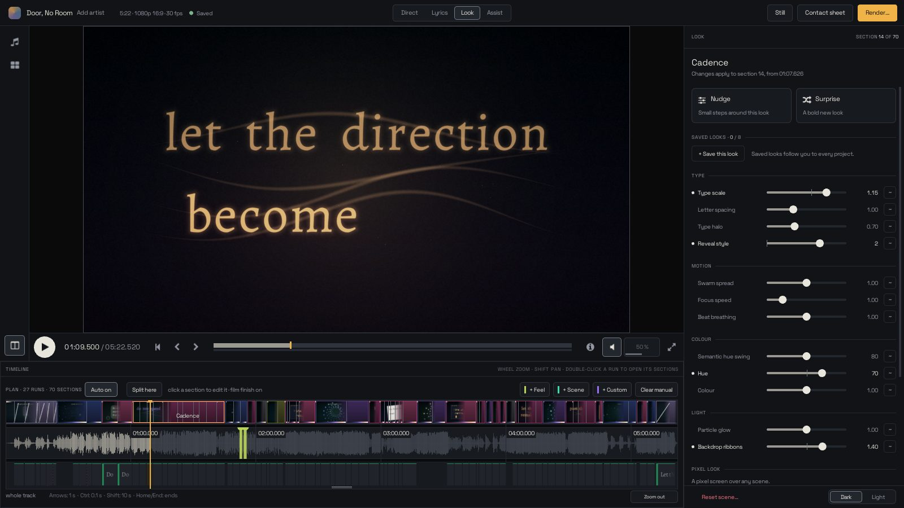

<p align="center">
  
</p>

<h1 align="center">Musializer</h1>

<p align="center">
  <strong>Give your music a video worth watching.</strong><br>
  A music visualization studio for Linux, built in Rust.
</p>

<p align="center">
  <a href="#get-started">Get started</a> ·
  <a href="#make-it-yours">What you can make</a> ·
  <a href="#lyrics-and-assist">Lyrics &amp; Assist</a> ·
  <a href="#let-an-agent-direct-it">Agents &amp; CLI</a> ·
  <a href="docs/README.md">Documentation</a>
</p>



Start with a song. Find a scene that suits it, let the bass move the picture,
give the chorus a different look, and put the words where they're sung.
Musializer brings scene direction, timed lyrics, and video export into one
workspace. Talk to an agent in Direct or shape each section by hand, with the
preview and timeline in view.

<table>
  <tr>
    <td width="33%"><br><sub>Pixel cats · Rose Window</sub></td>
    <td width="33%"><br><sub>Glyph Lattice</sub></td>
    <td width="33%"><br><sub>Fluid Ink</sub></td>
  </tr>
  <tr>
    <td><br><sub>Liquid Chrome</sub></td>
    <td><br><sub>Aurora Veil</sub></td>
    <td><br><sub>Stage</sub></td>
  </tr>
</table>

## Make it yours

**Find a look for your track.** Try luminous bars, landscapes, kinetic type,
or [Fluid Ink](docs/FLUID_INK.md)'s curling plumes. The
[scene gallery](docs/SCENE_GALLERY.md) ranges from reflective chrome to northern
lights and stained glass. [Pixel cats](docs/PIXEL_CATS.md) turns each lyric line
into a pixel-art gag. [Glyph Lattice](docs/GLYPH_LATTICE.md) sets light and words
in glowing cells. Each scene has its own controls and responds to your track.
The **Scenes** flyout groups them by family, with real poster frames rendered
from your track so you can choose by eye.



**Arrange the whole song.** Split the timeline into scenes, save different tuning
for each section, and place markers for moments you want to emphasize. Connect
volume, beats, spectral changes, or individual frequency bands to scene settings
through adjustable routes.

**Make lyrics part of the picture.** Edit cue text and timing, stack lines, import
a typeface, and choose placement, backing, glow, and shadow. Or let the line be
the picture: Cadence sets it as glowing kinetic type. Stage gives it a poster,
a terminal, a chat bubble, a stamped card, placards, or a market ticker.
The lyric timeline supports dragging, splitting, merging, tap timing, and undo.



**Choose your workspace.** **Direct**, **Lyrics**, **Look** and **Assist** share
one right column. Switch tabs while the preview, transport and timeline stay
put. Use Look to tune the scene and its pixel/CRT filter. Dark is the default;
choose Light at startup or in Look's footer. Your choice is remembered.



**Export for where you'll share it.** Render a landscape video, a square post,
or a vertical clip. Export a whole track, a selected time window, or a still.
High and Master quality use supersampling to preserve fine lines and bright
detail. MP4 export supports software encoding and optional NVIDIA encoders.

## Get started

Musializer is built and tested on Linux. You'll need **Rust 1.92 or newer**, a C
compiler, libclang, and the X11/OpenGL development libraries. The window uses X11
or XWayland; raylib 6.0 is bundled with the source.

On Debian/Ubuntu, install the build dependencies and a file picker:

```sh
sudo apt install build-essential pkg-config libclang-dev \
  libx11-dev libxrandr-dev libxinerama-dev libxcursor-dev libxi-dev \
  libgl1-mesa-dev zenity
```

`kdialog` can replace `zenity` on KDE. Install `ffmpeg` for video export and Assist.
The checked-in libclang path targets Debian/Ubuntu on x86-64; on another layout,
set `LIBCLANG_PATH` to the directory containing your libclang shared library.

```sh
git clone https://github.com/wolframs/rusty-musializer.git
cd rusty-musializer
cargo build --release
./target/release/musializer
```

Choose **Open audio** or drop a track into the window. You can also launch
directly into a song:

```sh
./target/release/musializer "path/to/song.mp3"
```

1. Open **Scenes** in the left rail and pick a poster. Try **Look** while the
   music plays.
2. Open **Lyrics** to edit words and timing; arrange sections on the timeline.
3. Choose **Render…** to open Render in the column. Set the shape, size and
   quality, then **Choose file and render** to save your video.

Save your work as a `.musi` project to return to its scenes, tuning, routes, and
lyrics. To add Musializer to your application menu and associate project files:

```sh
tools/install-linux-launcher.sh
```

Fonts and shaders are embedded; launching from another directory works too.

## Lyrics and Assist

Assist can analyze a track, suggest scene changes, and propose lyric timings.
Results are staged for review before you apply them to the project.

Local workflows use optional Python and audio-model tools. An experimental,
opt-in **Antigravity / Gemini audio route** can listen to short overlapping clips
and propose the phrases actually performed, including repeats and echoes. It
uses an installed, authenticated Antigravity ACP runtime and asks you to confirm
audio transfer for each job. Hosted OpenRouter workflows are also optional.

Automatic lyric timing is still being improved. Review the proposed words and
boundaries against playback; accuracy across whole tracks is not yet established.
You can always author and adjust cues manually.

Check which optional tools are available without starting a model or sending
audio:

```sh
python3 tools/musializer_doctor.py
python3 tools/musializer_doctor.py --require local_lyrics
```

See the [Assist guide](docs/ASSIST_PIPELINE.md) for setup and how proposals are
validated, or [analysis adapters](tools/ANALYSIS_ADAPTERS.md) for dependencies and
data handling.

<details>
<summary><strong>Render a saved project from the command line</strong></summary>

```sh
./target/release/musializer \
  --project performance.musi \
  --render performance.mp4 \
  --resolution 1080x1920 \
  --fps 30 \
  --quality master
```

Add `--render-window 30 15` to export 15 seconds starting at the 30-second mark.
Preview and export use the same scene, route, and timeline evaluation.
Run `./target/release/musializer --help` for all options.

</details>

## Let an agent direct it

**Talk to an agent beside the preview.** Open **Direct** for native chats with
Claude Code, Codex or Antigravity, or use its real terminal. Each agent needs
its own installed CLI and login. Ask it to shape a *treatment*: the file that
directs your video. Start the window with `--treatment song.treatment.json`, or
drop that file onto it, and the preview follows valid edits live. Keep the music
playing while you work on the next section together.
See the [workstation guide](docs/WORKSTATION.md) for the built-in sessions.

**Direct from the command line, too.** An agent, a script, or you in a terminal
can write a treatment, inspect frames, revise it, and render without the window.

**A treatment describes the whole video.** It says which scene plays when, how
each section is tuned, how it arrives (a burn, a flash on the drop, an iris out of black),
what the audio drives, and which lyric line is on screen from when to when.
Settings are named, not positional, and a mistake is refused by name with the
valid choices, so an agent can correct itself from the error.

```json
{
  "schema": "musializer.treatment/v1",
  "audio": { "path": "song.mp3" },
  "output": { "resolution": "1920x1080", "fps": 30, "quality": "high" },
  "segments": [
    { "at": 0,         "scene": "atlas",   "transition": { "kind": "iris", "seconds": 2 } },
    { "at": "0:24.5",  "scene": "orbital", "transition": { "kind": "flash", "seconds": 0.4 },
      "settings": { "reactivity": 1.6 } },
    { "at": "0:52",    "scene": "cadence", "transition": "burn",
      "settings": { "hue": 72, "reveal": 2 } }
  ],
  "outro": { "kind": "fade", "seconds": 2 },
  "lyrics": [ { "at": "0:53.7", "until": "0:56.6", "text": "the line being sung" } ]
}
```

**Write, look, revise, render.**

```sh
tools/headless_run.sh --vocabulary                       # 1. what can I name? scenes, settings, transitions
tools/headless_run.sh --treatment song.treatment.json \
  --contact-sheet sheet.png --sheet-at segments          # 2. one image of labelled frames to review
tools/headless_run.sh --treatment song.treatment.json \
  --still 24.7 drop.png                                  #    or single frames at chosen moments
tools/headless_run.sh --treatment song.treatment.json \
  --save-project song.musi --render song.mp4             # 3. the video, and a project you can open
```

- **`--vocabulary`** prints every scene with a line on how it looks, every
  setting with its bounds and default, and every transition, as JSON. It needs
  no display, so it is the first thing an agent should run.
- **`--contact-sheet`** and **`--still`** draw through the same path as the
  export, so what an agent reviews is what the video will contain. A sheet is
  how something without eyes on a screen watches four minutes in one image.
- **`--save-project`** writes an ordinary `.musi`. Open it in the window and
  keep working by hand; nothing about it is special.
- **`tools/headless_run.sh`** runs the app on a private virtual display, muted,
  and passes its arguments through. Nothing appears on your screen and nothing
  plays through your speakers while an agent works.
- **`tools/align_lyrics.py song.mp3 song.lyrics.json`** times the track's own
  embedded lyrics in seconds, and a treatment can take the file by path.

To try it, point your agent at this repository and a track and ask for a video.
The [directing guide](docs/MUSIC_VIDEO_CLI.md) is written for that reader: the
full format, what each report line means, and what the first video made this
way taught. [`docs/examples/example.treatment.json`](docs/examples/example.treatment.json)
is a complete treatment to start from.

Check section changes and lyric timing by ear before you post. Analysis and
alignment give you a starting point.
And transitions are authored in a treatment for now: the window plays them but
does not yet show or edit them.

## Build on it

The renderer, audio engine and column controls use **raylib 6.0**.
**egui 0.35** powers Direct, terminal sessions and the welcome theme picker.
The pure Rust core owns analysis, project data, and timing. Runtime code handles
audio devices, files, and helper processes.

```sh
tools/verify.sh --quick    # formatting, tests, lint, and offline checks
tools/verify.sh            # also captures and checks the app in private Xvfb
cargo build --release     # refresh the application you'll run
```

Automated playback is muted per process and isolated from desktop audio, with
the real decoded signal still reaching the analyzer. The optional
[Listening Lab](tools/listening-lab/) supports synchronized A/B listening and
timed-lyric comparisons when a judgment needs human ears.

| Looking for… | Start here |
| --- | --- |
| Workspace controls and themes | [UI toolkit](docs/UI_TOOLKIT.md) |
| Code ownership and data flows | [Architecture](docs/CODE_ARCHITECTURE.md) |
| A module or command | [Code map](docs/CODE_MAP.md) · [CLI and formats](docs/PHASE0_INVENTORY.md)