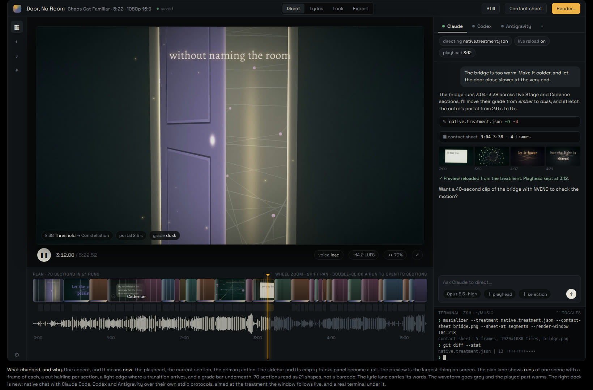

# WX — the window as a directing workstation

Opened 2026-10-21. The operator opened "Door, No Room" in the window, said the
interface was ugly ("MAN IS THIS INTERFACE UGLY, WHAT WAS I THINKING :D"), and
then asked for this:

> maybe it's feasible to take inspiration from `pingdotgg/t3-code` and implement
> Claude Code, Codex and Antigravity *into* the musializer main window. Or even
> just having a terminal emulator in there to run coding agents next to the work
> window would be good. … Best to split this into parts, set up a planning file,
> and progress through it :)

Earlier the same day they said they barely use the window by hand any more and
are "not married to the musializer's current UI". Videos are now directed by
agents writing treatments (`docs/MUSIC_VIDEO_CLI.md`). So the window's job
changes. It used to be a dense editor. Now it is where you **watch** a video
being directed and **talk** to whoever directs it. Editing by hand stays
possible, but it is no longer the main thing the window is for.

The queue row is WX in `FEATURE_PARITY_PLAN.md`. This file is the design record
and the status of each part.

## The mockup (WX-0)

**Approved by the operator, 2026-10-21: "That mockup is sick looking :O".**
`tools/wx_mockup.py PROJECT.musi STILLS_DIR OUT_DIR` regenerates it from any
project. It uses that project's frames, scene plan, lyric timing and
waveform; the image above is Door, No Room. It is a direction, not a pixel
spec:

- **One accent, meaning "now".** The playhead, the current section and the
  primary action. Today the same amber marks the track, the selected scene,
  Auto, the waveform and the progress bar, so nothing stands out.
- **The preview is the largest thing on screen.** The tracks sidebar and its
  mostly empty panel become a narrow rail with flyouts.
- **The plan lane shows runs.** Consecutive sections of one scene become one
  block with a frame from that scene. A hairline marks each cut, a light edge
  marks an arriving transition, and a bar underneath shows the grade. In the
  mockup, 70 sections read as 21 shapes instead of a barcode.
- **The lyric lane carries its words; the waveform is grey** and warms where
  it has played.
- **A dock on the right**, with tabs for Claude, Codex, Antigravity and a
  terminal.

## Parts, in build order

| Id | Part | Status |
| --- | --- | --- |
| WX-0 | Plan and mockup | done 2026-10-21 |
| WX-1 | The dock: a right-hand region the workspace makes room for | done 2026-10-21 |
| WX-2 | A real terminal in the dock, with one-click Claude / Codex / Antigravity tabs | done 2026-10-21 |
| WX-3 | The window follows a treatment file live | done 2026-10-21 |
| WX-4 | Native agent sessions: Claude Code, Codex, Antigravity | done 2026-10-21 |
| WX-5 | The restyle the mockup proposes | 5a (tokens and type) done 2026-10-24; 5b (the lane as runs, with poster frames) done 2026-10-24; 5c (rail and big preview) next |
| WX-6 | A headless gate for all of it | `tools/dock_check.sh` covers WX-1 to WX-4 (fake agents for all three protocols); WX-5 next |

### WX-1 — the dock

- It sits beside the workspace. It is **not modal**, unlike the egui Editor.
  The workspace lays itself out in a narrower window (`ShellInput.window`
  loses the dock's width), so no panel is covered and no hit test changes.
- It is egui, drawn in the same pass as the Editor and the welcome theme
  picker. There is one egui pass per frame, whatever is open.
- **Keyboard ownership is explicit.** While a dock surface has focus, every
  shell global stands down: Space, the arrows, `T`/`M`/`S`/`F`/`H`, Enter and
  Escape. A terminal is useless if Space pauses the song. A click anywhere in
  the workspace hands the keyboard back.
- It is toggled by a toolbar button and `` Ctrl+` ``. It can be resized by
  dragging its left edge. Whether it is open, and its width, persist in
  `ui.json`.

### WX-2 — the terminal

- `alacritty_terminal` provides the VT state machine and the PTY. Rendering is
  ours: one egui galley per row, in egui's bundled monospace face. Alacritty's
  terminal crate is what `egui_term` and Zed's terminal are built on. Writing
  our own VT parser would mean rediscovering 30 years of escape-code edge
  cases.
- The terminal runs `$SHELL` in the **project's folder** (or the track's
  folder, or `$HOME`). It sets `MUSIALIZER_PROJECT`, `MUSIALIZER_TRACK`,
  `MUSIALIZER_TREATMENT` when one is followed, and `MUSIALIZER_BIN`, so an
  agent started in it knows what the window is showing.
- It has tabs, scrollback, wheel scrolling (arrow keys in the alternate screen,
  as alacritty does), selection and copy (`Ctrl+Shift+C`), and paste
  (`Ctrl+Shift+V`).
- On close and on quit, the PTY's process group gets `SIGHUP` and is reaped.
  Agents run inside the terminal, so no stray agent outlives the window.

### WX-3 — live treatment

The useful loop: an agent edits a treatment in the dock, and the preview shows
it at once.

- When a session is started with `--treatment FILE`, the window **follows**
  that file. When its modification time changes, the file is recompiled and
  applied to the open track. The playhead, play state and selection stay where
  they are.
- A treatment that fails to compile changes nothing. The refusal goes to the
  notice tray, naming the field the same way the CLI does. The last good state
  stays on screen.
- The dock header shows the file being followed and when it was last applied.

### WX-4 — native agent sessions

Each of the three CLIs installed here speaks a structured protocol over stdio.
That is how t3-code drives them, so the dock can host them without running a
TUI inside a terminal:

| Agent | Transport |
| --- | --- |
| Claude Code | `claude -p --input-format stream-json --output-format stream-json --verbose` |
| Antigravity | `agy --input-format stream-json --output-format stream-json --print=` (its own `event`-tagged NDJSON; see below) |
| Codex | `codex app-server` (JSON-RPC over stdio) |

- The transcript model lives in `musializer-core`: pure, and fed by recorded
  streams in tests. The process lives in `musializer-runtime`, under the
  existing supervise-and-reap machinery. The chat view lives in the app.
- Context chips attach the playhead, the selected section and the followed
  treatment to a message. A short system note points the agent at
  `docs/MUSIC_VIDEO_CLI.md` and `tools/headless_run.sh`.
- A tool call shows as a one-line chip. Edits to the followed treatment
  trigger WX-3 by themselves; nothing extra is needed.
- Permissions: sessions start in the project folder, in the CLI's
  edit-accepting mode, without the dangerous skip flags. A permission prompt
  the protocol surfaces becomes an Allow / Deny row in the chat.
- **Credentials are never seen here.** Each CLI uses its own login. The
  OpenRouter E1 scrub (`runtime::assist::env`) already keeps the app's own key
  out of children.

### WX-5 — the restyle

What the mockup shows, moved onto egui panel by panel, through the command
boundary `docs/UI_TOOLKIT.md` describes. This overlaps with the open toolkit
follow-through and with CX-5 (scene thumbnails). Order: the colour and type
tokens first (visible everywhere, cheap), then the plan lane, then the rail.

The operator's frame for the run (2026-10-24): 5a, 5b and 5c in one run; the
secondary panels (Export, Tune, Lyrics, Assist, AI settings, protocol card,
Editor, dock) are **re-skinned only**, their layouts restructured in a later
wave; the dark mockup look becomes the default and the light appearance is kept
on the same tokens; the mockup is the spine and the details are free. Fixed: one
accent that means *now*, the plan lane as runs, the rail with flyouts, the
preview as the largest thing on screen.

**WX-5a, done 2026-10-24.** `ui/theme.rs` is the one source of colour and type:
a `Palette` per appearance (the mockup's dark workstation, and the light one on
the same roles), a type scale both toolkits read, and a corner radius for
controls. egui's visuals, text styles and face are derived from it. The rules
are in `docs/UI_TOOLKIT.md` ("Tokens and type"); the decisions are below.

**WX-5b, the lane, done 2026-10-24.** The plan lane draws **runs**: consecutive
sections of one scene folded into one block (`core::ui::plan_runs`), the scene
colour mixed toward the ground, a poster frame at its left (the poster
service, `posters.rs`, `docs/POSTER_FRAMES.md`, merged 2026-10-24), a hairline at each internal cut, and each section's transition
edge, glide ramp, grade bar and pixel mark inside its own span. The run under
the playhead has an inset accent outline and its section an accent tick.
Hit testing is unchanged and per section, so every gesture still works;
double-clicking a run zooms the view to it. The lane is 44 px (was 24). Split
in two by design (`build/redesign/wx5b-design.md` in the main checkout): the
lane here, the poster-frame service beside it, with a seam commit (`cbbe6b8`)
both were built against.

### WX-6 — gate

`tools/dock_check.sh`, using the gate's usual isolation. The terminal runs a
scripted `/bin/sh` command, and the capture is checked for its output and its
colours. Agent sessions run against **fake agent executables** that replay
recorded NDJSON. The gate never starts a real agent and never spends credits.

## Next sessions

The operator, 2026-10-21, after WX-0 to WX-4 landed: *"let's consolidate
ourselves here first. I'm thinking that we should do separate sessions for
the different steps following from here."* Each entry is one session's
brief: what to build, where it touches, and how a session knows it is done.
They are independent unless a line says otherwise. Every one finishes with
`tools/verify.sh` green and `cargo build --release`.

0. **First thing, before any WX-5 work** (operator, 2026-10-24: "first thing
   next session before the redesign"). Two small fixes left over from the
   scene upgrades:
   - **Done** (31e9c72). A treatment value exactly at a bound is refused:
     `scale` 0.3 reports "0.3 is outside 0.3..3". This looks like float
     precision in the treatment's bounds check (`core::treatment`). Fix it
     with a test at both ends of a few descriptors.
   - **Done** (2026-10-24). Aurora Veil's curtains still read bar-like at
     full intensity: their tops break into vertical blocks
     (`resources/shaders/glsl330/aurora_veil.fs`). Soften them into folds
     without losing the ray structure. Judge from a contact sheet of a loud
     passage. What caused it and what changed: `docs/ATMOSPHERE_SCENES.md`,
     "Why the tops fray".
1. **WX-5a: tokens and type.** *Done 2026-10-24; see the WX-5 section and
   the WX-5a decisions below.* One accent that means *now* (the playhead,
   the current section, the primary action), quiet selected states
   (outline plus tint, not a solid amber slab), one type scale, and the
   mockup's surfaces. Lives in `ui/theme.rs` (palette and egui visuals) and
   the shell's draw calls. It touches both themes. Expect the headless gate's
   colour assertions to move: update them on purpose, never loosen them
   (see "The headless gate runs on the GPU" in `AGENTS.md`). Done when a capture of Door, No Room
   at 1920x1080 reads like the mockup's chrome.
2. **WX-5b: the plan lane as runs.** *Done 2026-10-24, lane and poster
   service together.* Consecutive sections of one scene
   merge into one block with a frame from that scene, cut hairlines, a
   transition edge and a grade bar. The lyric lane shows its words, and
   the waveform is grey and warms behind the playhead. Lives in
   `ui/panels/scene_timeline.rs` and the timeline view. It needs per-scene
   thumbnails, which is CX-5's poster-frame service: build that here or
   take it from CX-5. Done when the 70-section Door plan reads as runs in a
   capture, and `scene marks:` still counts the same marks.
3. **WX-5c: the rail and the big preview.** The tracks sidebar and scene
   browser become a narrow icon rail with flyouts, and the preview takes the
   space. Biggest layout change; `core::ui::workspace_layout` and its
   `differential_layout.sh` harness are the contract. Update the harness on
   purpose, with a recorded reason, as `AGENTS.md` requires. Do this after
   5a, so the flyouts are drawn in the new tokens.
   The redesign also owns two picker decisions from the Pixel Cats merge
   (operator, 2026-10-24: "we'll fix it in the UI redesign"). Pixel Cats
   stopped at six stagings, because six is what a family shows without
   scrolling at the minimum picker size; the progress bar, pause menu,
   handheld and music box are unbuilt. And the family tabs became two rows
   of label-width tabs so a seventh family fits.
4. **WX-4 follow-ups**, small and independent:
   - inline images in a chat (a contact sheet or still the agent wrote);
   - a model picker per chat;
   - resuming a Codex thread after its process dies (`thread/resume`);
   - a "Follow a treatment…" picker in the dock;
   - a first real Codex and Antigravity turn through the dock. Both have
     only been exercised through their protocol probes, so far.
5. **VG: generated video as material.** Scoped in
   `docs/VIDEO_GENERATION.md`: five 1080p picks on OpenRouter, all with
   first and last frames. Building it spends money, so it starts with the
   consent and price-first route, then a treatment feature (a clip section,
   or a generated bridge between two sections' frames).
6. **Repair `tools/welcome_theme_check.sh`.** It fails on a fixed-pixel
   assertion ("editor did not replace the welcome step marker") at the
   commit before WX too. It predates this work and is not in
   `tools/verify.sh`.

## Decisions recorded along the way

**WX-5a (2026-10-24).**

- **The persisted names stay; their meaning moved.** `black-amber` is now the
  dark mockup look and the default, `light-blue` the light appearance. The
  operator's own `ui.json` already says `black-amber`, so their window opens in
  the new look; a `light-blue` file keeps the light one. `--ui-theme` also takes
  `dark` and `light`. The labels are now "Dark" and "Light".
- **The accent is worn by the playhead, the scene section under it (an inset
  outline in the plan lane), the current cue row, the live reading on a mapping
  plot, the render progress bar and the primary action** (Render, Open audio,
  Recover session) — and by nothing else, which `the_accent_is_worn_by_nothing_else`
  and the gate's accent census both measure. Everything that used to wear it
  moved to a role of its own: selection and focus to an outline and a tint,
  panel headings and emphasis to ink, filled amounts (sliders, meters, the scrub
  bar, the played waveform) to a warm grey, a blocked control's reason to the
  warning tone.
- **Two content colours moved off the accent.** The semantic ("Feel") event
  type was the C's amber `#F2BE42`, four degrees of hue from the new accent, so
  two feel markers on the waveform read as two more playheads; it is
  chartreuse now. The notice card's warning amber moved to orange for the same
  reason. Scene identity colours are unchanged here: Song Atlas and Voronoi
  Bloom sit near the accent's hue, which 5b's runs (darkened, with a poster
  frame) are the place to answer.
- **The waveform is grey ahead of the playhead and warm behind it** already in
  5a, because "nothing else wears the accent" forced a recolour and the two
  tones are the mockup's. 5b owns the lane itself.
- **Quiet control borders.** The mockup's buttons are told apart by their fill
  and label, and the old dark appearance's 6:1 control outlines made it read
  as a form. The palette test that required 3:1 control edges was replaced by
  one that requires the *selection* outline to clear 3:1 against the panels —
  the state a border was carrying — and by a contrast sweep that measures every
  chrome label on the hover and selected tints as well as on the panels.
- **The type scale shrank toward the mockup's.** Header 19 → 16, label 16 →
  14, value 15 → 14, a micro size of 11 for panel heads (uppercase, tracked),
  and fitted button rows capped at 16 (they could reach 22, which is how a
  scene tile said "Phosphor Dream" at 27 physical pixels). Caption stays 13
  because the timeline band reserves it, and moving the band moves every lane
  the gate measures. egui draws in Space Grotesk at the same sizes.
- **Controls are rounded (4 px); lanes and list rows are not.** A rounded
  corner on a time axis reads as a gap in it.
- **The gate runs as a user who chose the light appearance**, and the dark
  default has its own section. Every pixel threshold in `headless_check.sh` was
  measured on the light appearance, and the first dark run showed what that
  costs: the export panel's "darkest pixel under 200" ink check read the dark
  panel's own fill and passed on nothing. Converting thirty-odd absolute
  thresholds would have been a rewrite of checks that guard behaviour, not
  colour; keeping their appearance keeps every one of them as strong as it was.
  The new section checks the dark default for what it changed: the default
  itself, one time axis (the lane checker's border classifier inverts there),
  an accent census with a synthetic negative control, ink measured against the
  panel's own fill, and a tooltip.
- **The dark tooltip check found two light checks that had been passing on
  nothing.** The mute-button tooltip checks (100 % and 125 %) aimed at the
  transport row's old position, y=480 and y=599; the row had moved up, no tip
  was drawn, and their crops sat on the light panel, whose 247 cleared "text
  luma at least 180". Master's build does the same. They now aim at the row
  (1121x388, 978x486), crop above it, and each has a bare twin that must fail
  the brightness test and that the tip must add pixels to.
- **The waveform's two greys are tinted on purpose**: cool ahead of the
  playhead, warm behind it, in both appearances. The tick-plate check found
  the envelope by "bluer than red" while it was the accent; it now finds it by
  that channel order (blue > green > red, or red > green > blue), which no
  glyph, rule or event-marker hue has.
- **Negative controls run for this step:** the census fails a frame with an
  accent slab painted into the sidebar (every gate run) and a Render-bearing
  frame told it has no primary action; the dark lane check fails a light
  capture; the focus-ring check reads 0 added pixels with the ring drawn
  transparent against 560 with it (floor 132); the tick-plate check fails a
  label with three columns of either waveform tone painted into it; the
  dark export-ink check has a blank strip of the same panel as its control.

**WX-5b, the lane (2026-10-24).**

- **A run breaks on a scene change and nothing else.** Door, No Room's 70
  sections fold to 27 runs (the mockup's 21 was drawn by hand). A grade,
  transition, glide or pixel-look change stays a mark inside the run.
- **Folding is drawing only.** The section hit test is unchanged, so a cut
  inside a run is grabbed and dragged where its hairline is, and selection is
  an ink outline over the section's span. Double-click on a run zooms the view
  to it with 6 % either side ("open its sections"); `--ui-probe run-open=N`
  does the same, N counting from 1 like the report.
- **The lane reads the pointer through `Widgets::pointer`**, so `click=` can
  press it; it used to read raylib directly, which left the lane's gestures
  unreachable from any probe.
- **The poster slot is reserved whether or not a poster has arrived**, so the
  scene name does not jump when one does; with the service off
  (`posters=off`) the name takes the slot. The service (`posters.rs`) merged
  onto the lane on 2026-10-24; `tools/poster_check.sh` checks that each slot
  shows its run's poster upright.
- **Gate.** A new section seeds a seven-section plan with a known answer
  (`seed_lyric_fixture.py --run-plan`) and checks `scene runs:` and
  `scene marks:` exactly, counts exact-colour hairlines and the grade bar's
  step off the pixels (`tools/run_lane_check.py`), opens a run and presses a
  cut inside it from the report's own `lane=`/`view=`. Controls: an
  alternating-scene plan (seven runs, no hairline) and a one-grade plan (no
  step). Three older checks moved with the 20 px taller band and now read the
  layout from the report instead of a constant: the Spectrum floor crop and
  both mute-tooltip probes (whose bare twins caught the move on the first
  run). The ASCII footer probes moved from y=403 to y=383.

**WX-1/2 (2026-10-21).**

- **Agents run in terminal tabs first.** The Claude, Codex and Antigravity
  buttons open a tab that runs `$SHELL -i -c '<cli>; exec $SHELL -i'` in the
  project's folder. The agent gets the operator's own PATH, rc files and
  login, and quitting it leaves a shell in the tab. That is the operator's
  "even just a terminal emulator" request, and it works with every CLI today.
  WX-4's native chat comes on top of it; it does not replace it.
- **New tabs know where they are.** `MUSIALIZER_BIN` (this binary),
  `MUSIALIZER_PROJECT`, `MUSIALIZER_TRACK` and `MUSIALIZER_GUIDE` (the
  directing guide, when the binary sits in its checkout) are set. A new tab
  starts in the project's folder, else the track's, else `$HOME`.
- **The tab the dock opens by itself does not take the keyboard.** Tabs the
  user asks for do. Without this, a dock restored open at launch would swallow
  the first Space meant for the transport. The gate's negative control (the
  same run without `dock-focus=`) caught this on its first run.
- **Hide is not close.** Hiding the dock keeps its terminals running. Only a
  tab's `×` hangs up on it, and quitting hangs up on all of them.
- **Not done yet:** mouse reporting to full-screen programs (wheel scrolling
  in the alternate screen works through arrow keys, as alacritty does), and
  bold as a weight (it draws as a brighter colour). The terminal draws in
  egui's bundled Hack face. A glyph Hack and egui's fallbacks lack draws as
  a box.

**WX-3 (2026-10-21).**

- `--treatment` follows the file in a **session** only. A render, still,
  sheet or probe applies it once, because an export must not change under
  itself. `--ui-probe follow=1` opts a probe run in for the gate.
- **Audio identity is content.** A followed treatment written next to
  `door.mp3` directs `Door, No Room.musi`, whose audio is the bundled
  `Door, No Room.assets/audio/<sha>.mp3`. Without this, every project in
  `~/Music` would refuse the treatment that made it.
- Each apply marks the project modified, so autosave writes the `.musi`.
  The treatment is the source; the project follows it.
- **Not done yet:** a "Follow a treatment…" picker in the dock. For now the
  ways in are `--treatment` and dropping the file on the window.

**WX-4 (2026-10-21).**

- **The three protocols were read off live sessions, not documentation.**
  Each was probed with a one-line task on 2026-10-21 (Claude Code 2.1.301
  on Haiku, agy on Gemini 3.8 Flash Low, codex-cli 0.163.0). Antigravity
  turned out *not* to be Claude's format: its input is
  `{"event":"user","message":{"content":"…"}}`, its output is `step_update`s,
  and `-p` takes the next word as the prompt, so the dock puts `--print=`
  last. The tests in `core::agent` replay synthetic lines of each shape.
- **Permissions.** Claude runs with `--permission-mode acceptEdits` and
  `--permission-prompt-tool stdio`, so anything else it wants to do arrives
  as an Allow/Deny row. Codex runs with `approvalPolicy: on-request`, and its
  approvals are server requests answered the same way. Antigravity cannot ask
  in this mode: a refused action shows up in its result, and the chat says
  so and offers "let it run commands", which restarts it with
  `--dangerously-skip-permissions` and resumes its conversation. That is the
  operator's choice, made per chat, and nothing turns it on by default.
- **PATH.** A desktop launch does not read `.zshrc`, which is where Codex's
  npm bin and an nvm `node` usually come from. Agents are resolved and run
  with the login shell's interactive PATH, asked once in the background.
  `MUSIALIZER_AGENT_<NAME>` names an exact program instead. That override is
  the gate's seam: `tools/fake_agent.py` speaks all three protocols, and no
  check ever starts a real agent.
- **Context is visible.** The playhead line is prefixed to the message and
  shows in the user's bubble. The standing instructions go once per session:
  Claude's `--append-system-prompt`, Codex's `developerInstructions`, and the
  first message for Antigravity.
- **Live check, by hand, once:** a real Claude Code turn through the dock
  chat answered "pong" on Opus 5.5. Codex and Antigravity were exercised
  live only through the protocol probes above, not through the dock, to keep
  Codex's weekly limit for real work.
- **Not done yet:** inline images (a contact sheet the agent wrote should
  show in the chat), resuming a Codex thread after its process dies (Claude
  and Antigravity resume, Codex starts a new thread), and a model picker
  (each CLI uses its own configured default).

